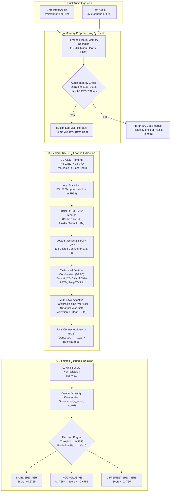
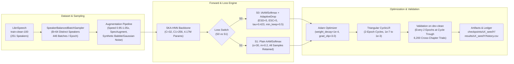

# Neurovox

**A research-oriented speaker verification system built around SKA-HNN, IAAMSoftmax and AdaptiveDrop.**

Neurovox combines an interactive biometric speaker verification application with a rigorous scientific reproduction and experimental investigation of recent advancements in deep speaker recognition. The system is centered on the **SKA-HNN** (Selective Kernel Attention-driven Hybrid Neural Network) backbone paired with **IAAMSoftmax** (Improved Additive Angular Margin Softmax) and **AdaptiveDrop** label cleansing, as introduced by Alam et al. (IEEE IJCNN 2025).

> **Scientific Scope & Reproduction Boundary**  
> Neurovox is a scaled reproduction on LibriSpeech `train-clean-100`, not an exact reproduction of the original paper's full-scale model. The network architecture has been scaled ($C=32, C_1=256$, 4.17M parameters) to evaluate on LibriSpeech's 251 training speakers and run within local compute envelopes (Apple Silicon Mac M3 Pro and Google Colab T4), while preserving the architectural stages, tensor flow, and loss formulation of the original study.

---

## 1. At a Glance: Headline Results & Demo Interface

### Three-Seed Experimental Headline (S0 vs S1 on `dev-clean`)

Neurovox evaluated the proposed architecture against an exact parameter-matched baseline across three independent random seeds (42, 43, 44), training for 30 epochs on LibriSpeech `train-clean-100` and validating every two epochs on `dev-clean` (6,200 cross-chapter trials).

| Metric | S0: Proposed (`IAAMSoftmax` + `AdaptiveDrop`) | S1: Baseline (Plain `AAMSoftmax`) | Difference (S0 − S1) |
| :--- | :---:| :---:| :---:|
| **Seed 42 Best EER** | 12.06% *(Epoch 30)* | 11.71% *(Epoch 28)* | +0.35% |
| **Seed 43 Best EER** | 11.77% *(Epoch 30)* | 11.71% *(Epoch 30)* | +0.06% |
| **Seed 44 Best EER** | 11.61% *(Epoch 28)* | 11.81% *(Epoch 28)* | −0.20% |
| **Mean Best EER** | **11.8133%** | **11.7433%** | **+0.0700%** |
| **EER Sample SD ($s$, $ddof=1$)** | 0.2281% | 0.0577% | — |
| **Seed 42 Best minDCF** | 0.4594 *(Epoch 26)* | 0.4506 *(Epoch 28)* | +0.0088 |
| **Seed 43 Best minDCF** | 0.4390 *(Epoch 28)* | 0.4729 *(Epoch 24)* | −0.0339 |
| **Seed 44 Best minDCF** | 0.4381 *(Epoch 30)* | 0.4552 *(Epoch 30)* | −0.0171 |
| **Mean Best minDCF** | **0.4455** | **0.4596** | **−0.0141** |
| **minDCF Sample SD ($s$, $ddof=1$)** | 0.0120 | 0.0118 | — |

*Note: All values measured on `dev-clean`. Minimum Detection Cost Function (minDCF) is computed at $P_{\text{target}} = 0.05$ with $C_{\text{miss}} = 1.0, C_{\text{fa}} = 1.0$. Standard deviations represent unbiased sample standard deviations ($ddof=1$). Best-EER and best-minDCF checkpoints frequently occur at different epochs across training.*

### Interactive Examiner Interface

The repository includes a production-grade FastAPI web application featuring an interactive dark-glass examiner dashboard:

```
+---------------------------------------------------------------------------------------------------------+
|  NEUROVOX    [Demo]  [How it works]  [Results]  [Models]  [Rigor]       DATASET: LibriSpeech   MODEL: S0    |
+---------------------------------------------------------------------------------------------------------+
|                                                                                                         |
|  [ CHANNEL 01: ENROLLMENT ]      [ BIOMETRIC DECISION ENGINE ]        [ TELEMETRY READOUTS ]            |
|  * Record (up to 10s)            |                             |      * Cosine Score:     +0.7935       |
|  * Upload audio file             |         /---------\         |      * Decision Thresh:   0.5755       |
|  * Real-time level meter         |        /     ▲     \        |      * Borderline Zone: [0.475, 0.675] |
|  * RMS & duration guards         |       |      |      |       |      * Enrollment Len:    5.24s        |
|                                  |        \           /        |      * Test Clip Len:     4.88s        |
|  [ CHANNEL 02: TEST CLIP ]       |         \---------/         |      * Active Checkpoint: s0_seed44    |
|  * Record (up to 10s)            |    SIMILARITY SCORE: +0.79  |      * Active Epoch:      28           |
|  * Upload audio file             |                             |      * Dev-Clean EER:     11.61%       |
|  * Real-time level meter         |      VERDICT: SAME SPEAKER  |      * Parameters:        4,167,700    |
|                                                                                                         |
+---------------------------------------------------------------------------------------------------------+
```

```markdown
<!-- Demo Interface Screenshot: Place a screenshot at docs/assets/demo_screenshot.png to view the live dashboard -->
```

---

## 2. Project Overview & Speaker Verification Primer

### What is Speaker Verification?

Speaker verification is a 1:1 biometric authentication task: given an enrollment recording of a claimed identity and an unverified test recording, the system determines whether both utterances were produced by the same individual. Unlike closed-set speaker identification (which selects from a fixed pool of known individuals), open-set speaker verification must generalize to previously unseen speakers whose voices were never encountered during training.

### How Neurovox Works

1. **Acoustic Preprocessing:** Raw audio is decoded in memory to 16 kHz mono floating-point PCM. An 80-dimensional log-Mel filterbank converts the time-domain waveform into a time-frequency acoustic representation using 25 ms Hamming windows with a 10 ms hop size.
2. **Deep Embedding Extraction:** The acoustic features pass through the SKA-HNN neural network, combining 2D convolutional selective attention, temporal recurrent modeling (TDNN-LSTM), multi-level feature combination, and attention-weighted statistical pooling. The penultimate linear layer projects the utterance representation into a 192-dimensional vector.
3. **Unit-Sphere Normalization:** The embedding vector is projected onto the unit hypersphere via $L_2$ normalization:
   $$\mathbf{e} = \frac{\mathbf{x}}{\|\mathbf{x}\|_2}$$
4. **Cosine Similarity Scoring:** Two speaker embeddings $\mathbf{e}_{\text{enroll}}$ and $\mathbf{e}_{\text{test}}$ are compared using cosine similarity:
   $$\text{score} = \cos(\theta) = \mathbf{e}_{\text{enroll}} \cdot \mathbf{e}_{\text{test}} \in [-1.0, +1.0]$$
5. **Calibrated Decision Boundary:** The score is compared against a decision threshold $\theta_{\text{thresh}}$ derived from the Equal Error Rate (EER) operating point on the development set (`dev-clean`). To convey biometric uncertainty responsibly, scores falling within a margin of $\pm 0.10$ around the threshold are assigned an `INCONCLUSIVE` verdict:
   $$\text{Verdict} = \begin{cases} \text{SAME SPEAKER}, & \text{if } \text{score} > \theta_{\text{thresh}} + 0.10 \\ \text{DIFFERENT SPEAKERS}, & \text{if } \text{score} < \theta_{\text{thresh}} - 0.10 \\ \text{INCONCLUSIVE (BORDERLINE)}, & \text{if } |\text{score} - \theta_{\text{thresh}}| \le 0.10 \end{cases}$$

### Dual Facets: Interactive Application vs. Research Investigation

Neurovox encompasses two tightly integrated components:

- **The Interactive Application:** A FastAPI backend serving a responsive, accessible browser interface. It enables live microphone recording, file uploads, in-memory decoding via FFmpeg pipes, instantaneous embedding extraction, dynamic SVG similarity gauging, and comprehensive system telemetry.
- **The Research Investigation:** An experimental testbed evaluating the hybrid neural backbone (SKA-HNN) and testing the central hypothesis of IAAMSoftmax and AdaptiveDrop: does iterative sample filtering and label correction provide measurable performance or robustness advantages over plain AAMSoftmax?

---

## 3. Key Implemented Capabilities

### Biometric Verification Application

- **Dual-Channel Input:** Independent audio channels for enrollment (known voice) and test (unverified voice).
- **In-Memory Audio Ingestion:** Client-side Web Audio capture and multi-format file upload (`.wav`, `.flac`, `.ogg`, `.webm`, `.mp3`, `.m4a`). Decoded to 16 kHz mono float32 purely in memory via FFmpeg pipes without intermediate disk I/O.
- **Audio Integrity Guards:**
  - *Hard Duration Bounds:* Rejects recordings under 1.0 second or over 30.0 seconds with HTTP 400.
  - *Silence & Low-Energy Rejection:* Rejects low-energy clips below an RMS amplitude threshold of 0.005 (~ −46 dBFS) to prevent extracting embeddings from microphone noise or silence.
  - *Short-Clip Caution:* Displays a non-blocking UI alert when input durations are between 1.0 and 3.0 seconds, alerting the user to potential degradation in biometric reliability.
- **Biometric Scoring & Decision Engine:** Computes cosine similarity, applies the checkpoint-specific calibrated threshold, and renders verdicts (`SAME`, `DIFFERENT`, `INCONCLUSIVE`).
- **Interactive SVG Similarity Gauge:** Dynamic radial gauge visualizing the raw score, decision threshold marker, and colored borderline zone.
- **Verified Audio Examples:** Instant one-click execution of curated LibriSpeech `test-clean` verification trials (genuine cross-chapter pairs and impostor pairs).

### Research & Telemetry Dashboard

- **5-Tab Mission-Control Layout:** Structured navigation across `Demo`, `How it works` (interactive module inspection), `Results` (experimental dashboard), `Models` (parameter audits), and `Rigor` (scientific integrity protocols).
- **Automated Headline Aggregation:** Reads local results directories (`results/s0_seed*`, `results/s1_seed*`), computes multi-seed means and sample standard deviations ($ddof=1$), and renders per-epoch convergence curves.
- **Explicit Separation of Completed vs. Pending Experiments:** Dynamically marks completed multi-seed headline results as `measured`, while keeping planned synthetic label-noise sweeps, baseline comparisons, and architecture ablations strictly identified as pending.

---

## 4. Research Background & Theoretical Context

### Reference Publication

- **Paper Title:** *"A Hybrid Neural Approach to Speaker Verification with an Improved Additive Angular Margin Loss"*
- **Authors:** Jahangir Alam, Abderrahim Fathan, and Md Shahidul Alam
- **Venue:** IEEE International Joint Conference on Neural Networks (IJCNN 2025)

### Central Research Question

> *Does combining an attention-driven hybrid neural network (SKA-HNN) with an adaptive sample-cleansing loss (IAAMSoftmax with AdaptiveDrop) provide a measurable advantage over conventional Additive Angular Margin Softmax (AAMSoftmax), particularly under clean versus noisy training-label regimes?*

### Headline Configurations Investigated

To isolate the contribution of the proposed loss and sample-handling mechanics from the backbone architecture, Neurovox investigates two headline configurations:

1. **S0 — Proposed Configuration (`IAAMSoftmax` + `AdaptiveDrop`):**
   - **Backbone:** Scaled SKA-HNN ($C=32, C_1=256$, 4,167,700 parameters).
   - **Loss Formulation:** Additive Angular Margin Softmax ($s=30.0, m=0.2$).
   - **AdaptiveDrop Dynamics:**
     - *Warm-up Period:* 5 epochs ($\text{ESD}=5$ `[Paper]`), during which standard margin loss is applied without dropping samples.
     - *Label Correction:* Initiated at epoch 5 ($\text{ESC}=5$ `[Engineering Choice]`). If target cosine similarity satisfies $\cos\theta_y < \tau$ (with $\tau=0.423$ `[Paper]`) and an alternate speaker prototype satisfies $\max_{c \ne y} \cos\theta_c \ge \tau_{\text{corr}}$ (with $\tau_{\text{corr}}=0.5$ `[Engineering Choice]`), the sample's label is reassigned to $\arg\max_c \cos\theta_c$.
     - *Sample Filtering:* Samples with $\cos\theta_y < \tau$ that cannot be corrected are dropped from gradient computation.
     - *Minimum Keep-Ratio Safeguard:* A deterministic fallback guard (`min_keep_ratio=0.5` `[Engineering Choice, ADR-001]`) retains the top-50% highest-cosine samples in any batch to prevent batch starvation and gradient collapse during early training.
2. **S1 — Controlled Baseline Configuration (Plain `AAMSoftmax`):**
   - **Backbone:** Identical scaled SKA-HNN ($C=32, C_1=256$, 4,167,700 parameters).
   - **Loss Formulation:** Standard AAMSoftmax ($s=30.0, m=0.2$).
   - **AdaptiveDrop:** Disabled. Every training sample contributes gradient updates across all 30 epochs.

**Why S1 is an Essential Baseline:** Without S1, any performance differences could not be attributed to the loss function rather than the novel SKA-HNN architecture itself. S1 holds the backbone capacity, receptive fields, optimizer, and training schedule strictly constant, isolating the specific influence of AdaptiveDrop.

### Scaled Architectural Dimensions

The original paper trained a 30.91M parameter network on the VoxCeleb2 dataset (5,994 speakers). To reproduce and evaluate the methodology on LibriSpeech `train-clean-100` (251 speakers) while avoiding catastrophic overfitting and staying within single-GPU compute budgets, Neurovox scaled the internal dimensions:

| Architectural Parameter | Paper Full-Scale `[Paper]` | Neurovox Scaled `[Engineering Choice]` | Rationale / Provenance |
| :--- | :---:| :---:| :--- |
| **Training Corpus** | VoxCeleb2 Dev (5,994 speakers) | LibriSpeech `train-clean-100` (251 speakers) | Feasible academic reproduction corpus |
| **Acoustic Filterbank ($F$)** | 80 Mel bins | 80 Mel bins | Matched acoustic front-end `[Paper]` |
| **2D-CNN Channels ($C$)** | 128 | 32 | Prevents capacity overparameterization |
| **TDNN/LSTM Channels ($C_1$)** | 512 | 256 | Capacity matching for 251 speaker classes |
| **Flattened CNN Dim ($d_c$)** | 2,560 | 640 | $d_c = C \times (F / 4) = 20 \times C$ `[Paper]` |
| **MLFC Combination Dim ($d_i$)** | 3,584 | 1,152 | $d_i = d_c + 2C_1$ `[Paper]` |
| **MLASP Bottleneck Dim ($d_{\text{attn}}$)** | 256 | 128 | Attention scoring bottleneck `[Engineering Choice]` |
| **Embedding Dimension** | 192 | 192 | Standard biometric speaker embedding size `[Paper]` |
| **Backbone Trainable Parameters** | ~30.91M | **4,167,700** | Measured via `torchinfo` |

---

## 5. System Architecture & Workflows

### Inference Pipeline (Audio Input to Verification Verdict)



### Research Training Workflow



### Key Modules and Code Organization

- [`src/features/mfb.py`](file:///Users/aanyavarshney/Documents/GitHub/Neurovox/src/features/mfb.py): 80-dimensional log-Mel filterbank extraction with pre-emphasis and Hamming windowing.
- [`src/models/ska_hnn/resblock.py`](file:///Users/aanyavarshney/Documents/GitHub/Neurovox/src/models/ska_hnn/resblock.py): SKA ResBlock combining Conv2D, frequency-wise selective attention ([`fw_ska.py`](file:///Users/aanyavarshney/Documents/GitHub/Neurovox/src/models/ska_hnn/fw_ska.py)), channel-wise selective attention ([`cw_ska.py`](file:///Users/aanyavarshney/Documents/GitHub/Neurovox/src/models/ska_hnn/cw_ska.py)), and Squeeze-and-Excitation ([`se.py`](file:///Users/aanyavarshney/Documents/GitHub/Neurovox/src/models/ska_hnn/se.py)).
- [`src/models/ska_hnn/local_stats.py`](file:///Users/aanyavarshney/Documents/GitHub/Neurovox/src/models/ska_hnn/local_stats.py): Non-parametric sliding-window local mean $\mu_t$ and standard deviation $\sigma_t$ calculated strictly in `torch.float32` with variance clamping (`min=1e-5`) to eliminate catastrophic cancellation.
- [`src/models/ska_hnn/tdnn_lstm.py`](file:///Users/aanyavarshney/Documents/GitHub/Neurovox/src/models/ska_hnn/tdnn_lstm.py): Hybrid time-delay convolution (k=3) followed by a unidirectional LSTM.
- [`src/models/ska_hnn/mlasp.py`](file:///Users/aanyavarshney/Documents/GitHub/Neurovox/src/models/ska_hnn/mlasp.py): Multi-Level Attentive Statistics Pooling module computing channel-dependent attention weights across temporal frames.
- [`src/losses/iaam_softmax.py`](file:///Users/aanyavarshney/Documents/GitHub/Neurovox/src/losses/iaam_softmax.py): IAAMSoftmax loss with AdaptiveDrop label correction, sample filtering, and empty-batch guard.
- [`src/losses/aam_softmax.py`](file:///Users/aanyavarshney/Documents/GitHub/Neurovox/src/losses/aam_softmax.py): Numerically stable standard AAMSoftmax baseline.
- [`src/training/trainer.py`](file:///Users/aanyavarshney/Documents/GitHub/Neurovox/src/training/trainer.py): Training engine with NaN detection guards at every batch, stateful RNG checkpointing for bitwise resume parity, and structured metric logging.
- [`app/server.py`](file:///Users/aanyavarshney/Documents/GitHub/Neurovox/app/server.py): FastAPI web server with FFmpeg memory decoding, dynamic threshold caching, and multi-seed result aggregation.

---

## 6. Dataset and Experimental Setup

### Dataset Partitioning

Experiments are conducted on the official LibriSpeech ASR corpus (OpenSLR 12). Partitions are constructed with strictly mutually disjoint speaker sets to eliminate leakage:

| Partition | Role in Pipeline | Total Speakers | Multi-Chapter Speakers | Target Trials | Impostor Trials | Total Trials |
| :--- | :--- | :---:| :---:| :---:| :---:| :---:|
| `train-clean-100` | Model Training & Loss Cleansing | 251 | 251 | — | — | 28,539 utts |
| `dev-clean` | Hyperparameter Tuning & Threshold Calibration | 40 | 31 | 3,100 | 3,100 | 6,200 |
| `test-clean` | Held-Out Final Evaluation *(Pending)* | 40 | 29 | 2,900 | 2,900 | 5,800 |
| `test-other` | Held-Out Challenging Evaluation *(Pending)* | 33 | 29 | 2,900 | 2,900 | 5,800 |

> **Strict Cross-Chapter Trial Protocol:** To eliminate recording condition shortcuts, target trials pair utterances spoken by the same individual reading from strictly different book chapters. Speakers with only a single recorded chapter are excluded from genuine target trials (9 in `dev-clean`, 11 in `test-clean`, 4 in `test-other`), guaranteeing that 100% of target trials reflect true acoustic cross-chapter variation.

### Training Configuration

| Parameter | Implemented Value | Verification Source |
| :--- | :--- | :--- |
| **Dataset** | LibriSpeech `train-clean-100` | Configured in [`configs/s0_full.yaml`](file:///Users/aanyavarshney/Documents/GitHub/Neurovox/configs/s0_full.yaml) |
| **Number of Speakers** | 251 | Audio manifest: `data/manifests/train-clean-100.csv` |
| **Number of Utterances** | 28,539 | Audio manifest: `data/manifests/train-clean-100.csv` |
| **Backbone Architecture** | SKA-HNN | Implemented in [`src/models/ska_hnn/ska_hnn.py`](file:///Users/aanyavarshney/Documents/GitHub/Neurovox/src/models/ska_hnn/ska_hnn.py) |
| **2D-CNN Channels ($C$)** | 32 | Channel width scaling |
| **TDNN-LSTM Channels ($C_1$)** | 256 | Frame-level feature scaling |
| **Trainable Parameters** | 4,167,700 | Measured via `torchinfo.summary()` |
| **Batch Size ($B$)** | 64 | Distinct speakers per batch (446 batches / epoch) |
| **Training Epochs** | 30 | Full training run budget |
| **Validation Interval** | Every 2 epochs | Full-utterance trial evaluation on `dev-clean` |
| **Numerical Precision** | Strictly FP32 | Enforced across all tensors; no AMP/GradScaler on MPS |
| **Optimizer** | Adam | $\beta_1=0.9, \beta_2=0.999, \text{weight\_decay}=10^{-4}, \text{grad\_clip}=3.0$ |
| **Learning Rate Schedule** | Triangular `CyclicLR` | 2-epoch full cycles (1 epoch up, 1 epoch down) |
| **Learning Rate Range** | $1.0\times 10^{-7}$ (base) to $1.0\times 10^{-3}$ (max) | Stepped per batch with `cycle_momentum=False` |
| **Active Augmentations** | Speed, SpecAugment, Synthetic Noise | Speed: 0.95–1.05x ($p=0.5$); SpecAugment ($p=0.5$); Noise ($p=0.3$); Babble ($p=0.4$) |

*Note on Learning Rate Schedule:* Audited training records confirm that training utilized PyTorch's triangular `CyclicLR` with two-epoch cycle periods, stepping once per mini-batch. Evaluations on `dev-clean` occur at even-numbered epochs (2, 4, 6, ..., 30), aligning exactly with the trough of the cyclic schedule ($1.0\times 10^{-7}$).

---

## 7. Experimental Results & Scientific Interpretation

### Detailed Per-Seed Metrics

Across 30 epochs on LibriSpeech `train-clean-100`, checkpoints were evaluated on `dev-clean` at every even epoch. The table below presents the verified minimum EER, minimum minDCF, and corresponding checkpoint epochs:

| Configuration | Seed | Best Dev EER (%) | Epoch (Best EER) | minDCF@0.05 at Best EER | Best minDCF@0.05 | Epoch (Best minDCF) | EER at Best minDCF (%) | Total Train Time (s) |
| :--- | :---:| :---:| :---:| :---:| :---:| :---:| :---:| :---:|
| **S0** (`IAAMSoftmax` + `AdaptiveDrop`) | 42 | 12.06% | 30 | 0.4748 | 0.4594 | 26 | 12.65% | 7,787.9s (~2.16h) |
| **S0** (`IAAMSoftmax` + `AdaptiveDrop`) | 43 | 11.77% | 30 | 0.4629 | 0.4390 | 28 | 12.44% | 7,100.8s (~1.97h) |
| **S0** (`IAAMSoftmax` + `AdaptiveDrop`) | 44 | **11.61%** | 28 | 0.4574 | **0.4381** | 30 | 11.90% | 7,989.3s (~2.22h) |
| **S1** (Plain `AAMSoftmax`) | 42 | 11.71% | 28 | 0.4506 | 0.4506 | 28 | 11.71% | 8,284.0s (~2.30h) |
| **S1** (Plain `AAMSoftmax`) | 43 | 11.71% | 30 | 0.4777 | 0.4729 | 24 | 12.03% | 6,831.6s (~1.90h) |
| **S1** (Plain `AAMSoftmax`) | 44 | 11.81% | 28 | 0.4623 | 0.4552 | 30 | 12.23% | 7,933.2s (~2.20h) |

### Summary Statistics ($N=3$ Random Seeds)

| Metric | S0 (`IAAMSoftmax` + `AdaptiveDrop`) | S1 (Plain `AAMSoftmax`) | Delta (S0 − S1) |
| :--- | :---:| :---:| :---:|
| **Mean Best EER (%)** | **11.8133%** | **11.7433%** | +0.0700% |
| **EER Sample Std Dev ($s$, $ddof=1$)** | 0.2281% | 0.0577% | — |
| **EER Population Std Dev ($\sigma$, $ddof=0$)** | 0.1862% | 0.0471% | — |
| **Mean Best minDCF ($P_{\text{target}}=0.05$)** | **0.4455** | **0.4596** | **−0.0141** |
| **minDCF Sample Std Dev ($s$, $ddof=1$)** | 0.0120 | 0.0118 | — |
| **minDCF Population Std Dev ($\sigma$, $ddof=0$)** | 0.0098 | 0.0096 | — |
| **Mean minDCF at Best EER** | 0.4650 | 0.4635 | +0.0015 |
| **Mean Total Training Time** | 7,626.0s (~2.12h) | 7,682.9s (~2.13h) | −56.9s |

### Scientific Findings & Interpretation

1. **Comparable Overall Accuracy on Clean Labels:** S1 achieved a marginally lower mean best EER (11.7433% vs 11.8133%, a delta of 0.07%), while S0 achieved a lower mean best minDCF (0.4455 vs 0.4596, an improvement of 0.0141).
2. **Inconsistent Advantage Across Seeds:** On seeds 42 and 43, S1 achieved lower EER than S0 (11.71% vs 12.06% and 11.77%). On seed 44, S0 outperformed S1 (11.61% vs 11.81%). The ranking between configurations reverses depending on random initialization.
3. **Absence of Statistical Significance:** With sample standard deviations of 0.2281% (S0) and 0.0577% (S1), the 0.07% difference in mean EER is within experimental variance. An evaluation across three random seeds does not establish statistical significance.
4. **Impact of Clean Training Data:** LibriSpeech `train-clean-100` consists of clean audiobook speech with verified speaker annotations and virtually zero ground-truth label noise. Under these conditions, AdaptiveDrop's sample filtering discarded very few samples: retention in seed 42 began at 86.8% at epoch 5 and grew to 96.6% by epoch 30, and the emergency fallback guard never triggered.
5. **Core Hypothesis Status:** The primary theoretical claim of AdaptiveDrop is robustness under *noisy training labels*. On clean training data, AdaptiveDrop functions primarily as hard-example dropping, which does not yield a significant performance gain over standard AAMSoftmax. The critical scientific test of AdaptiveDrop resides in planned synthetic label-noise injection experiments (Tier 3).

---

## 8. Demo Checkpoint & Calibrated Operating Point

The interactive web demo loads the best overall model checkpoint identified across all headline experimental runs:

| Attribute | Verified Value |
| :--- | :--- |
| **Configuration** | **S0** (`IAAMSoftmax` + `AdaptiveDrop`) |
| **Random Seed** | Seed 44 |
| **Checkpoint Epoch** | Epoch 28 |
| **Filesystem Path** | [`checkpoints/s0_seed44/best_dev_eer.pt`](file:///Users/aanyavarshney/Documents/GitHub/Neurovox/checkpoints/s0_seed44/best_dev_eer.pt) |
| **Checkpoint SHA-256** | `4e445c042951d7c83b4f7ce48c1f5c0feb1e618f18d4b45ee495d87a094460db` |
| **Trained Parameters** | 4,167,700 |
| **Measured `dev-clean` EER** | **11.61%** |
| **Associated minDCF ($P=0.05$)** | 0.4574 |
| **Calibrated Decision Threshold** | **0.5755** (cosine similarity operating point) |
| **Inconclusive (Borderline) Band** | **[0.4755, 0.6755]** ($\text{threshold} \pm 0.10$) |

### Operating Point and Threshold Caveats

- **Operating Point Selection:** The threshold ($0.5755$) was determined by evaluating 6,200 cross-chapter trials on the development set (`dev-clean`) and identifying the point where False Acceptance Rate (FAR) equals False Rejection Rate (FRR).
- **Zero Test Set Leakage:** The decision threshold is derived strictly from development trials. The test sets (`test-clean` and `test-other`) remain completely untouched.
- **Model-Specific Calibration:** The 0.5755 threshold is specific to this exact checkpoint, the scaled SKA-HNN architecture, and the 80-channel log-Mel frontend. It is not an acoustic constant and must not be applied to other models or feature sets without recalibration.

---

## 9. Installation & Environment Setup

### System Prerequisites

- **Operating System:** macOS (Apple Silicon M-series recommended) or Linux (Ubuntu 20.04+).
- **Python Version:** Python 3.10, 3.11, or 3.12 (Python 3.12.5 verified).
- **FFmpeg:** Required on system `PATH` for client-side and server-side in-memory audio decoding:
  ```bash
  # macOS (Homebrew)
  brew install ffmpeg

  # Ubuntu / Debian
  sudo apt-get update && sudo apt-get install -y ffmpeg
  ```

### Repository Setup

```bash
# 1. Clone the repository and navigate to root
git clone https://github.com/aanyavarshneyav/Neurovox.git
cd Neurovox

# 2. Create and activate a clean virtual environment
python3 -m venv .venv
source .venv/bin/activate

# 3. Upgrade packaging tools
pip install --upgrade pip setuptools wheel

# 4. Install dependencies in editable mode
pip install -e ".[dev,demo]"
# Or install via requirements.txt:
# pip install -r requirements.txt
```

### Dataset Acquisition & Manifest Preparation

If you intend to train models or run offline evaluations, acquire the LibriSpeech partitions:

```bash
# Download and unpack LibriSpeech splits into data/raw/
python scripts/download_data.py --splits train-clean-100 dev-clean test-clean test-other --confirm

# Generate CSV metadata manifests in data/manifests/
python -m src.data.prep_librispeech --raw-dir data/raw --out-dir data/manifests

# Generate cross-chapter evaluation trial lists in data/trials/
python -m src.data.trial_generator --manifest data/manifests/dev-clean.csv --out-dir data/trials
```

> **Git Storage Policy:** Audio files (`data/`), model checkpoints (`checkpoints/`, `*.pt`), and raw cache files are strictly excluded from git tracking via `.gitignore`. Checkpoints are generated locally via the training scripts.

---

## 10. Running the Interactive Verification Demo

To launch the verification server and interactive web frontend:

```bash
python3 app/server.py --host 127.0.0.1 --port 8000 --device cpu
```

*(Note: Running demo inference on `cpu` is recommended so any background training jobs on `mps` or `cuda` remain uninterrupted.)*

### Verification Walkthrough

1. Open your browser and navigate to `http://127.0.0.1:8000/`.
2. **Channel 01 (Enrollment):** Click **Record** to capture your voice (up to 10 seconds), or upload an audio file.
3. **Channel 02 (Test Clip):** Record a second utterance or upload another speech sample.
4. Alternatively, click **Run example: same speaker** or **Run example: different speakers** in the action bar to load verified `test-clean` audio pairs immediately.
5. Click **Verify speakers**.
6. The system displays the cosine similarity score on the dynamic radial gauge, renders the final verdict (`SAME`, `DIFFERENT`, or `INCONCLUSIVE`), and displays detailed clip telemetry.

### Input Constraints & Requirements

- **Microphone Security Context:** Modern browsers require a secure context (`https://` or `http://localhost` / `http://127.0.0.1`) to access the microphone.
- **Duration Limits:** Clips must be between 1.0 second and 30.0 seconds.
- **Audio Cleanliness:** Speech clips with RMS energy below 0.005 (~ −46 dBFS) are rejected as silence.
- **Short-Clip Warning:** Clips between 1.0 and 3.0 seconds produce a warning alert regarding biometric variance.

---

## 11. Reproducing Experiments

### Running Headline Multi-Seed Training

To run the sequential S0 (proposed) and S1 (baseline) training pipeline for a given random seed:

```bash
# Run headline training for Seed 42
./scripts/run_headline.sh 42

# Run headline training for Seed 43
./scripts/run_headline.sh 43

# Run headline training for Seed 44
./scripts/run_headline.sh 44
```

On macOS, `run_headline.sh` invokes `caffeinate -ims` to prevent system idle sleep during long training jobs. Each 30-epoch training run requires approximately 2.0 to 2.3 hours on an Apple M3 Pro chip (~4.2 to 4.5 hours per seed for both S0 and S1).

### Standalone Training Script

You can also run training directly with custom configurations or hardware overrides:

```bash
python scripts/train.py \
    --config configs/s0_full.yaml \
    --run-id custom_s0_run \
    --seed 42 \
    --device mps
```

### Standalone Evaluation Script

To evaluate any saved checkpoint against a trial list with speaker-level clustered bootstrap confidence intervals:

```bash
python scripts/evaluate.py \
    --checkpoint checkpoints/s0_seed44/best_dev_eer.pt \
    --trials data/trials/trials_dev-clean.txt \
    --device cpu \
    --bootstrap-iterations 1000
```

---

## 12. Repository Structure

```
Neurovox/
├── app/                              # Interactive web application
│   ├── server.py                     # FastAPI backend (endpoints, FFmpeg decoding, threshold caching)
│   └── static/                       # Web frontend assets
│       ├── index.html                # Dark-glass examiner dashboard (5 tabs)
│       ├── style.css                 # Responsive stylesheet & mission-control design
│       └── app.js                    # Client-side audio recording, SVG gauge, results charts
├── configs/                          # Experiment configuration YAMLs
│   ├── base.yaml                     # Shared defaults (audio front-end, optimizer, sampler)
│   ├── s0_full.yaml                  # S0 Headline: SKA-HNN + IAAMSoftmax + AdaptiveDrop
│   ├── s1_full.yaml                  # S1 Headline: SKA-HNN + Plain AAMSoftmax
│   └── sanity_*.yaml                 # Overfit, smoke, and active AdaptiveDrop diagnostic configs
├── data/                             # Dataset storage (Git-ignored)
│   ├── manifests/                    # CSV manifests (train-clean-100, dev-clean, test-clean)
│   └── trials/                       # Cross-chapter trial lists (trials_dev-clean.txt, etc.)
├── docs/                             # Engineering and research documentation
│   ├── ARCHITECTURE.md               # Module tensor contracts and ablation switches S0-S6
│   ├── BENCHMARKS.md                 # Measured hardware throughput & dataloader latency
│   ├── DATA_PROTOCOL.md              # Cross-chapter trial generation & partition specs
│   ├── DECISIONS.md                  # Architectural Decision Records (ADR-001 through ADR-021)
│   ├── EXPERIMENT_PLAN.md            # Five-tier experimental roadmap & compute budgets
│   ├── OPEN_QUESTIONS.md             # Unverified paper items & working assumptions
│   ├── PROJECT_SPEC.md               # Complete architectural & algorithmic specification
│   └── RESULTS_LOG.md                # Append-only experimental ledger of all measured runs
├── results/                          # Metric outputs & per-epoch histories (JSON/CSV)
│   ├── s0_seed42/                    # S0 seed 42 history.csv and run_meta.json
│   ├── s1_seed42/                    # S1 seed 42 history.csv and run_meta.json
│   ├── s0_seed43/                    # S0 seed 43 history.csv and run_meta.json
│   ├── s1_seed43/                    # S1 seed 43 history.csv and run_meta.json
│   ├── s0_seed44/                    # S0 seed 44 history.csv and run_meta.json
│   └── s1_seed44/                    # S1 seed 44 history.csv and run_meta.json
├── scripts/                          # Utility & operational automation scripts
│   ├── run_headline.sh               # Sequential S0/S1 headline execution runner
│   ├── train.py                      # Main model training entrypoint
│   ├── evaluate.py                   # Standalone checkpoint evaluation & bootstrap CI
│   ├── benchmark_hardware.py         # Hardware throughput and layer latency benchmark
│   └── download_data.py              # Resume-capable OpenSLR 12 downloader
├── src/                              # Neurovox core Python package
│   ├── data/                         # Dataset, augmentation, sampler, trial generation
│   ├── eval/                         # EmbeddingExtractor, EER, and minDCF scoring
│   ├── features/                     # 80-channel log-Mel spectrogram extraction
│   ├── losses/                       # IAAMSoftmax and standard AAMSoftmax losses
│   ├── models/                       # SKA-HNN model family, ECAPA-TDNN baseline
│   ├── training/                     # Trainer loop, NaN guards, resume mechanics
│   └── utils/                        # Project paths, configuration loaders
├── tests/                            # Comprehensive Pytest test suite (127 unit tests)
├── pyproject.toml                    # PEP 518/621 project configuration & dependencies
└── requirements.txt                  # Pinned application and training dependencies
```

---

## 13. Testing and Code Verification

The codebase includes an extensive automated test suite covering model tensor shapes, gradient flow, numerical stability, loss mechanics, and server endpoints.

To run the full suite:

```bash
pytest
```

**Verified Test Suite Status:**
- **Result:** 127 passed in 15.10 seconds (0 failures, 0 errors).
- **Key Modules Tested:**
  - `test_ska_hnn.py`: Exact tensor input/output shapes across fwSKA, cwSKA, SE, ResBlock, Local Statistics, TDNN-LSTM, MLASP, and FC heads.
  - `test_iaam_softmax.py`: Margin projection, cosine similarity calculation, AdaptiveDrop warm-up, label correction, sample dropping, and `min_keep_ratio` safeguard.
  - `test_trainer.py`: Deterministic loss reduction, Adam optimizer stepping, triangular CyclicLR per-batch update, NaN/Inf crash guards, and stateful RNG resume parity.
  - `test_server.py`: FastAPI endpoints, in-memory audio decoding, duration rejection (<1s, >30s), RMS silence rejection (<0.005), and SHA-256 threshold cache validation.
  - `test_data_integrity.py`: Assertion of zero speaker overlap across partitions and 100% cross-chapter pairing in verification target trials.

---

## 14. Scientific Limitations & Incomplete Experiments

In accordance with strict scientific integrity, the limitations of the current implementation and the boundary between completed and pending research are stated explicitly:

1. **Scaled Model Capacity:** Neurovox is a scaled reproduction ($C=32, C_1=256$, 4.17M parameters) evaluated on LibriSpeech `train-clean-100` (251 speakers). It is not the full-scale 30.91M-parameter network evaluated on VoxCeleb2 (5,994 speakers) described in the original paper.
2. **Clean-Speech Baseline Performance:** Best dev-clean EERs are in the range of 11.6% to 12.1%. By comparison, large models trained on thousands of hours of conversational speech achieve EERs under 3%. LibriSpeech `train-clean-100` provides limited acoustic diversity.
3. **Acoustic Domain Sensitivity:** Biometric comparisons between clean audiobook speech and low-quality microphone recordings can cause false rejections due to acoustic domain shift. Short utterances (under 3 seconds) exhibit increased score variance.
4. **Checkpoint-Specific Thresholds:** The decision threshold (0.5755) is calibrated specifically for the seed-44 checkpoint on `dev-clean`. Applying this threshold to other models or acoustic domains will produce uncalibrated decisions.
5. **Statistical Indeterminacy on Clean Data:** Three seeds are insufficient to demonstrate a statistically significant performance difference between S0 and S1 on clean labels.
6. **Robustness Under Label Noise Remains Unverified:** The primary claimed benefit of AdaptiveDrop is resilience to training label noise. On clean LibriSpeech labels, AdaptiveDrop behaves essentially like standard AAMSoftmax. The hypothesis that AdaptiveDrop outperforms AAMSoftmax under label corruption can only be validated once the synthetic noise sweeps are completed.
7. **Pending Baseline & Ablation Runs:**
   - *ECAPA-TDNN Baseline:* The parameter-matched ECAPA-TDNN model ($C=400$, 4.12M parameters) is implemented and tested, but full 30-epoch training has not yet been executed.
   - *Architecture Ablations:* Model code and config flags for S2 (no MLASP context), S3 (no MLFC), S5 (vanilla Conv2D), and S6 (no 2D-CNN) are implemented and parameter-verified, but their training runs remain pending.
   - *Self-Supervised Proxy (K-Means):* Tier 3 pseudo-label clustering using frozen WavLM representations has not yet been conducted.
   - *Held-Out Test Set Evaluation:* Final evaluations on `test-clean` and `test-other` have been deliberately deferred until all development training is locked, preventing test set snooping.

---

## 15. Research Roadmap

The following experimental phases represent planned and pending extensions:

- [ ] **Controlled Synthetic Label-Noise Sweeps (Tier 3A):** Evaluate S0 and S1 under symmetric label corruption at 10%, 20%, and 40% noise injection to rigorously test AdaptiveDrop's label cleansing hypothesis.
- [ ] **Parameter-Matched ECAPA-TDNN Baseline (Tier 0):** Execute 30-epoch training across 3 seeds on the 4.12M parameter ECAPA-TDNN model to provide a matched capacity benchmark against SKA-HNN.
- [ ] **Ablation Matrix Training (Tier 2):** Complete 30-epoch runs for S2, S3, S5, and S6 to isolate the contributions of the 2D-CNN frontend, multi-level feature combination, and local statistics pooling.
- [ ] **Self-Supervised Representation Clustering (Tier 3B):** Extract frozen WavLM-Base+ representations, cluster into 251 pseudo-speaker classes via K-Means, and evaluate S0's filtering on unsupervised cluster assignments.
- [ ] **Final Held-Out Evaluation:** Evaluate the best checkpoints on `test-clean` and `test-other` using 1,000-iteration speaker-level paired bootstrap resampling to compute 95% confidence intervals.

---

## 16. Citation & Provenance

If referencing this project or its experimental findings, please cite the original research paper:

```bibtex
@inproceedings{alam2025hybrid,
  author    = {Alam, Jahangir and Fathan, Abderrahim and Alam, Md Shahidul},
  title     = {A Hybrid Neural Approach to Speaker Verification with an Improved Additive Angular Margin Loss},
  booktitle = {Proceedings of the IEEE International Joint Conference on Neural Networks (IJCNN)},
  year      = {2025}
}
```

### Engineering Provenance Tags

Following strict scientific reporting guidelines, design decisions in this repository carry explicit tags:
- `[Paper]`: Architectural detail or hyperparameter taken directly from Alam et al. (IJCNN 2025).
- `[Engineering Choice]`: Deliberate design or scaling choice documented in [`docs/DECISIONS.md`](file:///Users/aanyavarshney/Documents/GitHub/Neurovox/docs/DECISIONS.md) (e.g. $C=32, C_1=256$, `min_keep_ratio=0.5`).
- `[External-UNVERIFIED]`: Derived from external literature or reference implementations, tracked in [`docs/OPEN_QUESTIONS.md`](file:///Users/aanyavarshney/Documents/GitHub/Neurovox/docs/OPEN_QUESTIONS.md).
